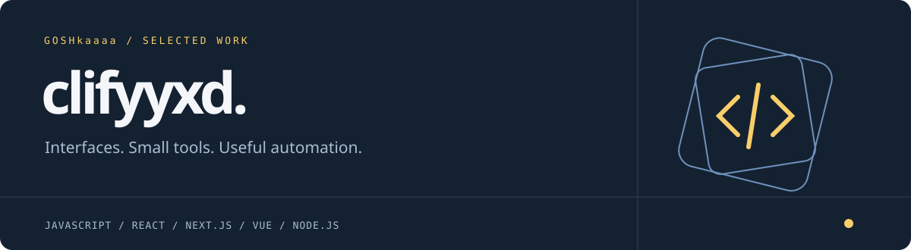
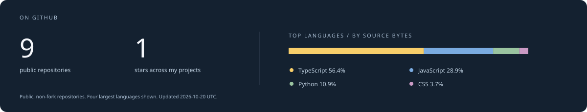

I build things with JavaScript: browser tools, web interfaces, bots, and scripts that take a repetitive job off your hands.

Currently working with **React, Next.js, Vue, and Node.js**. I like projects with a clear purpose, a considered interface, and a small enough scope to finish properly.

### Selected projects

<table>
<tr>
<td width="33%" valign="top">

<h3>Wayfarer</h3>

A day-by-day trip planner with a budget, portable backups, and Markdown export.

<b>Next.js · React · JavaScript</b>

<a href="https://goshkaaaa.github.io/wayfarer/">Try it</a> · <a href="https://github.com/goshkaaaa/wayfarer">Code</a>
</td>
<td width="33%" valign="top">

<h3>Pigment</h3>

Find a palette, lock your favorite colors, check contrast, and export usable CSS.

<b>Vue 3 · Vite · JavaScript</b>

<a href="https://goshkaaaa.github.io/pigment/">Try it</a> · <a href="https://github.com/goshkaaaa/pigment">Code</a>
</td>
<td width="33%" valign="top">

<h3>Interval</h3>

A focus timer that handles background time, with tasks and a seven-day activity view.

<b>React · Vite · JavaScript</b>

<a href="https://goshkaaaa.github.io/interval/">Try it</a> · <a href="https://github.com/goshkaaaa/interval">Code</a>
</td>
</tr>
</table>

### Also on my workbench

- [koisu-downloader](https://github.com/goshkaaaa/koisu-downloader)
- [Backup Spotify playlists](https://github.com/goshkaaaa/Backup-Spotify-playlists)
- [Subscription tracker](https://github.com/goshkaaaa/Subscription-tracker)

### Stack

### A few real numbers

The statistics above come from the GitHub API and are rendered in this repository. [Data](assets/metrics.json) · [Update workflow](.github/workflows/metrics.yml)
